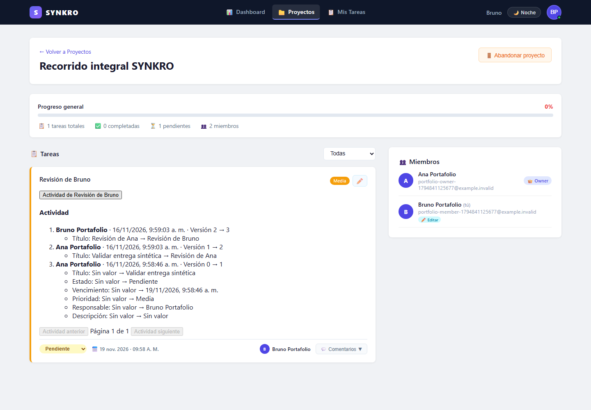

# SYNKRO — proyectos y tareas en equipo

SYNKRO ayuda a equipos pequeños a organizar proyectos, responsables, vencimientos y comentarios sin perder cambios cuando dos integrantes editan una tarea. Interfaz en español, permisos por proyecto y tablero Kanban.

## Funcionalidades

- Propietarios y miembros con permisos separados de creación/edición; comentarios y moderación.
- Sesiones revocables, refresh rotativo, recuperación al recargar y cierre coordinado entre pestañas.
- Tareas versionadas, conflictos que conservan borradores, revisión explícita e historial transaccional.
- Kanban con teclado, reconciliación por tarea y recuperación ante red incierta.
- Correos de asignación, vencimiento próximo y vencida mediante trabajos durables, deduplicación, leases y reintentos acotados.
- Mailpit local, demo idempotente, instalación PowerShell/Compose y CI configurado.

## Instalación rápida en Windows

Requiere Docker Desktop con contenedores Linux y PowerShell 5.1 o posterior. No necesita Node/Python globales para operar con contenedores.

```powershell
powershell -NoProfile -ExecutionPolicy Bypass -File .\scripts\synkro.ps1 -Accion Instalar
.\iniciar_proyecto.bat -Accion Demo
```

Interfaz http://localhost:5173 · API http://localhost:3000 · Mailpit http://localhost:8025.

**Instalación existente:** si ya existe el volumen histórico sin `.env`, el instalador se detiene para que conserves las credenciales originales. No cambia contraseñas de una base inicializada. Sigue [instalación y baseline](docs/installation.md) antes de migrar.

```powershell
.\iniciar_proyecto.bat -Accion Iniciar
.\iniciar_proyecto.bat -Accion Detener
.\iniciar_proyecto.bat -Accion Estado
.\iniciar_proyecto.bat -Accion Actualizar -SinNavegador
```

Actualizar usa el código presente; no hace git pull/reset. Detener conserva datos. Demo se carga solo cuando se solicita: ana.demo@example.invalid, bruno.demo@example.invalid y carla.demo@example.invalid; contraseña inicial `SynkroDemo2026!`, exclusivamente local. Repetir no restablece datos editados ni contraseñas.

## Stack y arquitectura

Node 22, Express 5.3.0, TypeScript 5.9.3, Prisma 5.22 y PostgreSQL 15 en Compose (tests aislados también en PostgreSQL 17). React 19.3.1, Vite 7.3.8, Context API, Axios y @dnd-kit. Python 3.13, FastAPI/Uvicorn y SMTP; versiones exactas en lockfiles y requirements.txt.

La API Node centraliza negocio y persistencia en PostgreSQL. Python reclama trabajos mediante HTTP interno protegido, entrega SMTP y confirma resultado; no accede a tablas de negocio. Nginx sirve la SPA compilada. Mailpit es buzón de desarrollo. No hay Redis, brokers ni WebSockets. [Arquitectura](docs/architecture.md).

`.env.example` describe Compose; el instalador genera secretos solo para configuración nueva. Cloudinary es opcional: sin él se conserva avatar de inicial/color y se informa indisponibilidad de carga. No hace falta SMTP externo. Desarrollo sin Docker y contratos técnicos: documentación enlazada abajo.

## Verificación

51 pruebas backend, 29 frontend, 7 Python y 4 E2E Chromium aprobados; builds y lint frontend global pasan. Integración SMTP real en Mailpit y recorrido Compose con dos usuarios, permisos, conflicto, historial y teclado Kanban ejecutados. Instalación en snapshot sin dependencias, ruta con espacios/Unicode, demo repetida, reinicio y actualización comprobados. [GitHub Actions aprobado](https://github.com/fmarquezrojas-dev/Sistema-de-Gestion-de-proyectos-y-tareas-/actions/runs/43892056352) sobre el commit `a6eda70`.

[Comandos de pruebas](docs/testing.md) · [Evidencia, límites y pendientes](docs/release-readiness.md).

## Capturas reales

Datos sintéticos del recorrido local:



[Tablet](docs/screenshots/tablet.png) · [Móvil](docs/screenshots/mobile.png)

## Límites conocidos

Entorno local de portafolio, no despliegue productivo certificado. SMTP aceptado no significa entrega final; unknown requiere revisión explícita y no se reenvía a ciegas. Historial sujeto a cascadas existentes. Sin sincronización instantánea por WebSockets. No hay purga automática de trabajos/sesiones. Dependencias de producción sin hallazgos de npm audit en la verificación; herramientas de desarrollo mantienen deuda documentada. Cloudinary, SMTP externo, HTTPS productivo y navegadores distintos de Chromium no se verificaron.

## Documentación

- [Instalación](docs/installation.md), [operación y respaldo](docs/operations.md).
- [Autorización](docs/authorization.md), [sesiones](docs/authentication.md), [concurrencia](docs/task-concurrency.md).
- [Notificaciones y administración local](docs/notifications.md).
- [Pruebas](docs/testing.md), [roadmap](docs/roadmap.md), [informe de cierre](docs/release-readiness.md), [cambios](CHANGELOG.md).

Entrega disponible en el [PR en borrador #1](https://github.com/fmarquezrojas-dev/Sistema-de-Gestion-de-proyectos-y-tareas-/pull/1). No se publicaron tags, releases ni imágenes; main permanece sin cambios. Licencia y autoría existentes conservadas.
