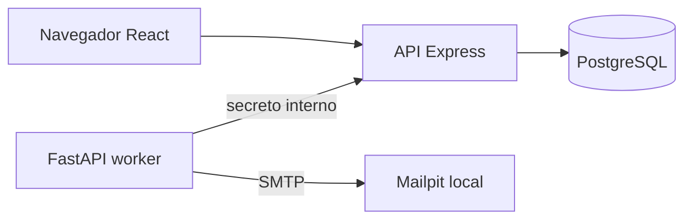

# Arquitectura de SYNKRO

React/TypeScript, Context API, Axios y @dnd-kit implementan la SPA. Express/TypeScript centraliza autorización por proyecto, sesiones, tareas versionadas, comentarios, historial y trabajos de notificación. Prisma es el acceso de aplicación a PostgreSQL. Python/FastAPI reclama trabajos mediante HTTP interno y entrega SMTP. La persistencia es centralizada en PostgreSQL; Python no tiene credenciales de base.

La API funciona para tareas aunque el worker/SMTP esté apagado: conserva la intención transaccional. La entrega necesita API, DB y SMTP disponibles; fallos conocidos se reintentan de forma acotada. No hay broker ni garantías exactly-once. Mailpit es herramienta de desarrollo, no servicio de negocio.

Las sesiones usan refresh opaco httpOnly y access en memoria, comprobación persistida de revocación, coordinación Web Locks/BroadcastChannel y Origin estricto. El entorno local HTTP usa NODE_ENV=development; producción requiere HTTPS y cookie Secure. No se ofrece Compose local como despliegue endurecido de producción.

Las mutaciones de tareas coordinan autorización, asignación, versión y ActivityLog bajo SERIALIZABLE. Los comentarios no cambian versión. Las notificaciones conservan contexto de asignación/vencimiento, sin alterar versión por procesar trabajos. Detalles en authorization.md, authentication.md, task-concurrency.md y notifications.md.

Cloudinary es opcional; los avatares mantienen inicial/color. No se exige SMTP externo para demo. Los endpoints live/ready separan proceso y consulta DB; la salud del worker no afirma entrega SMTP. No se midieron rendimiento, disponibilidad ni SLA.
